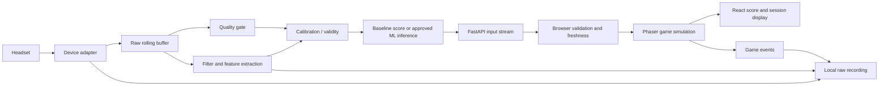

# Neumont BCI: complete build blueprint

**Implementation update (October 8):** The guided Connect → Calibrate → Balance flow, recorded-file verification/plots, explicit baseline and endless rounds are now implemented. Current behavior and test procedure are in [the walkthrough](replay-and-connection.md) and [architecture](architecture.md). Earlier 60-second-round and manual-input proposals below are superseded; remaining task estimates need to account for these completed components.


Working game title: **Brain Balance**. Planning baseline: October 8, 2026. This is the implementation map for the club's workstreams. It supersedes the earlier rough task estimates. The code already in this repo is a manual/synthetic starter, not the completed live BCI product.

## 1. Product and decisions

Build one local browser game: a virtual wooden beam pivots, a ball rolls, and the player tries to maximize time inside a center zone during a 60-second round. React provides connection/calibration/instructions/results; Phaser renders the game. Python receives the headset, assesses quality and produces a normalized EEG feature score. That score changes disturbance strength, giving more or less balancing assistance.

The selected interaction is **EEG-assisted balance**. The game's controller performs fast centering corrections. The player modulates a slower EEG feature and sees assistance change. It is a neurofeedback game, not a demonstrated general left/right thought decoder. This distinction must be visible in the pitch and UI. Whether people can intentionally modulate the chosen feature is a feasibility question with its own test, not assumed from a changing signal.

A functional live MVP needs actual headset access, quality checks, calibration and full session lifecycle. A functioning synthetic game alone does not satisfy the live MVP. ML is optional: compare it with a simple baseline and adopt it only if the evaluation and live experience justify it.

Three firm technology decisions: React/TypeScript + existing Phaser version; local Python/FastAPI; one scalar input protocol. One conditional decision: BrainFlow vs vendor/LSL adapter, selected after exact headset/firmware/OS/access are known.

## 2. Source/reuse plan

The [detailed reuse matrix](blueprint/reuse-matrix.md) lists source repos, exact adaptable example files, licenses, alternatives and our required custom code.

| Layer | Reuse | We write |
| --- | --- | --- |
| UI | React components/hooks and browser DOM | Connection/calibration/play/results flow, status and instructions, original visual design |
| Game | Phaser renderer, scenes, input and scaling | Ball dynamics, assistance/disturbance mapping, scoring, lifecycle and polish |
| Acquisition | BrainFlow BoardShim or one vendor/LSL route | Device config, shared worker, reconnect, metadata and adapter boundary |
| Numerical processing | BrainFlow DataFilter and NumPy | Channel/window selection, quality policy, feature pipeline configuration |
| Calibration | NumPy statistics | Participant baseline, valid-data criteria, normalization and reset rules |
| Local service | FastAPI, Uvicorn, Pydantic | Input/status schemas, controls, shared broadcast, bounded queues, error policy |
| Recording/replay | BrainFlow read/write helpers or NumPy + standard-library files | Session manifests, synchronized events, explicit replay timing/source |
| ML experiment | scikit-learn preprocessing/classifiers/splitters/metrics | Our dataset, evaluation design, feature version, report and inference wrapper |
| Verification | Node test runner, pytest/TestClient, Playwright | Our quality, calibration, game and session acceptance scenarios |
| Showcase | Existing laptop/browser/headset | Launch instructions, operator runbook, poster, rehearsal and labeled backup |

This replaces low-level framework and signal-processing work with existing implementations. It does not replace our product behavior or the work of proving that our signal is useful.

No full third-party BCI game is selected as the base. The inspected upstream components fit a narrow adapter better than importing another complete application's acquisition, UI and model assumptions. The existing repo is the base; install dependencies and adapt small upstream examples into it.

## 3. End-to-end architecture



Run the browser and backend on the same showcase laptop. The game loop runs independently of incoming EEG packets. An acquisition worker reads samples; processing emits approximately 4 score packets/second; rendering targets the display refresh rate. A rolling 2–4-second feature window creates feedback lag even when packet delivery is fast. Measure window lag and processing/delivery lag separately.

One process owns the headset session. Opening a second tab must not create a second device connection. Use bounded buffers/queues; a slow browser receives the latest state instead of accumulating minutes of old input. Source changes are explicit, reset the participant/game state and never happen as a silent fallback.

## 4. Complete component specifications

### 4.1 UI and session state

Screens: welcome/instructions; connection/quality; calibration; gameplay; results. These can be panels in one React app; routing is unnecessary. States: disconnected → connecting → checking signal → calibrating → ready → playing → paused → finished. Failed calibration returns to quality/setup, not ready. Disconnect during a round enters paused/error; recovery requires fresh data and an explicit resume. Reset abandons the current round and clears participant calibration. Changing input mode ends/resets the round.

Display persistent source label (manual/synthetic/live/replay), quality/pause reason, assistance input, round time and time-in-zone score. Keep raw EEG graphs in an operator panel. Use helpful calibration progress based on accumulated valid data, not a cosmetic countdown. Do not label a feature score “calmness” unless the team has supporting evidence.

Files to evolve: `App.tsx`, `style.css`; planned `session.ts`, `components/ConnectionPanel.tsx`, `CalibrationPanel.tsx`, `RoundHUD.tsx`, `ResultsPanel.tsx`. Start with fixture states and agree on props with API/game leads.

### 4.2 Simulation, renderer and gameplay

Keep `simulation.ts` as a deterministic numerical model that can be tested without React/Phaser. Phaser's scene handles drawing and optional practice input. Initial ball coordinates are dimensionless relative to the beam; the target half-width is currently 0.15. The display centers and scales to its container.

Use a fixed timestep independent of display FPS. Clamp angle and input, handle ball ends consistently, and make pause stop simulation, timer and scoring. Current model rebounds at beam limits; falling off is not a required feature. A new round uses the same initial state and disturbance schedule for comparable tests.

Current mapping: increasing score reduces the disturbance amplitude. The existing automated centering controller remains fixed. Tune the low/high extremes so assistance matters without creating trivial perfection or impossible play. Expose constants as named configuration. Retain the current constrained model; add Matter physics only if free fall/collisions become an approved new mechanic.

Formal score is time in the center zone during 60 valid playing seconds, bounded by 0–60. Record paused wall time separately. Practice rounds may have keyboard steering; live/EEG evaluation rounds must disable it. Score differences show game mapping, not proof of psychological change.

### 4.3 Headset adapter and raw buffer

Before coding the adapter record make/model/firmware, electrode locations, host OS, raw-data permissions/subscriptions, SDK version, transport, actual sampling rate, channel map/units and contact-quality support. Complete the [headset spike](blueprint/headset-spike.md). Do not invent a board id or choose brain features before knowing the channels.

Proposed adapter methods: connect(config), start(), read_samples(), stop(), disconnect(), describe(). Sample batches carry channel data plus timestamps, channel names, units and sampling rate. Store EEG channels separately from timestamp/marker/accelerometer rows. Preserve the raw data before any in-place filtering. Avoid device reads on the async server event loop; use one acquisition worker with clean cancellation.

Bound the raw buffer to the analysis window plus a small margin (e.g., 10 seconds), configurable from actual sample rate. Report gaps and disconnect rather than filling them with zeros and declaring good quality. Reconnect clears the analysis window and requires renewed baseline/confirmation according to the session state.

### 4.4 Signal quality and preprocessing

Evaluate required channels, sample timestamps/gaps, finite data, clipping/flatlining, vendor contact flags where available, and obvious movement/muscle artifacts. Exact numeric thresholds are set from the actual device/pilot data. Do not present amplitude heuristics as a complete artifact classifier.

Mark a window poor when it fails requirements; poor windows do not count toward calibration, score updates or training data unless intentionally labeled as rejected. Include an understandable reason. Use artifact challenge recordings (blink, jaw tension, head motion, deliberately poor contact) to see whether a “high score” is actually contamination. Quality gating must run before trusting any model.

Preprocessing proposal: copy selected EEG window; remove offset/detrend; apply a justified bandpass and mains-noise treatment; estimate PSD; extract powers. Validate frequencies against Nyquist and actual rate. Choose one filter path and account for edge/transient effects. The upstream filtering sample demonstrates several operations; it is not our production chain. Online windows and offline ML features must use matching operations, ordering and metadata.

Feature candidates: log powers by band/channel, relative band power with valid denominator, or a simple feature shown repeatable in our pilot. Do not stack many exploratory ratios into production. A known-frequency synthetic signal validates code only; it cannot validate a participant's mental-state interpretation.

### 4.5 Calibration and score

Collect approximately 30–60 seconds of valid baseline data, subject to the pilot. Reject insufficient/flat/poor-quality baselines. Choose one repeatable eyes-open feature; closed-eye alpha demonstrations can help inspect a device but are not automatically useful while watching a game.

A starting normalization can use a participant baseline median and robust spread to map a feature to [0,1], with bounded output and documented smoothing. The mapping is configurable and must reject near-zero spread. Baseline-fit parameters are separate from classifier-training parameters. Record the feature identifier/direction so “higher input” is interpretable. Smoothing has one owner (prefer backend score processing); avoid adding multiple unknown moving averages across layers.

Repeat calibration for a new visitor. Test within-person repetitions and instructed attempts to modulate the feature. An EEG feature changing spontaneously does not establish intentional control. If modulation is not repeatable, present it as exploratory feedback and review the input choice before claiming the intended interaction works.

### 4.6 Protocol, commands and lifecycle

The currently implemented InputFrame v1 remains the agreed narrow input contract: version, sequence, timestamp_ms, source, score [0,1], quality good/poor, calibrated boolean. `/ws/input` already exists. Browser freshness uses monotonic receipt time, not server wall time. Reject malformed, duplicate or out-of-order packets. Poor, uncalibrated, disconnected or >2-second stale input pauses play.

Planned additive fields: session_id, feature_id, quality_reason, window_start_ms/window_end_ms and model_version where applicable. Plan/update Python and TypeScript validators together before sending them; keep old fixtures valid unless a deliberate version bump is made.

Planned HTTP controls (not implemented in the starter):

| Endpoint | Contract / behavior |
| --- | --- |
| GET `/api/status` | Source, device state, session id, calibration progress/state, quality reason, last error; UI may poll about once/second |
| POST `/api/device/connect` | Connect configured device once; acknowledge ready/error; duplicate connect must be safe |
| POST `/api/calibration/start` | Begin a new valid-data baseline; reply calibrating or actionable error |
| POST `/api/session/reset` | Clear participant baseline/round-linked backend state; acknowledge before UI declares new visitor ready |
| POST `/api/device/disconnect` | Stop collection/release device and report disconnected |

Start/finish game timing belongs to the browser; backend needs timestamped game/task events for recording when enabled. Define a small event route within DATA-06/API-03, not a separate cloud service. Bind service to loopback, configure frontend backend URL, and allow the actual local frontend origin for control requests. No accounts/database/server hosting are needed for the station.

### 4.7 Recording and replay

For voluntary development sessions, record raw channel arrays and timestamps plus JSON metadata. Log features/input frames, quality reasons, calibration parameters and task/game events as CSV/JSONL with session ids and time alignment. Anonymous local filenames and ignored `data/` are sufficient. Do not use game score as an ML class label.

Replay has two useful levels: recorded InputFrames for frontend/integration tests and raw samples reprocessed through the feature pipeline for data/ML debugging. MVP backup requires frame replay; raw replay is included in the data task as an analysis aid. Preserve original recording timestamps but emit fresh delivery metadata; label replay, reset sequence per connection and pause when replay ends.

The original recordings and derived model artifacts remain local unless the team explicitly chooses an appropriate sharing method. Synthetic fixtures belong in Git. Data consent/retention instructions must precede volunteer collection.

### 4.8 Optional machine learning

Research question: do labeled instructed conditions yield more reliable, usable control than the calibrated feature baseline? Reuse scikit-learn's algorithms rather than building classifiers from scratch.

Pilot proposal: at least 3 volunteers, 2 sessions each, approximately 15–20 minutes per session including setup, and repeated short quiet-rest/mental-arithmetic blocks with similar eyes-open posture. Counterbalance task order, timestamp labels, and skip transition windows. This is an engineering feasibility pilot, not a justified sample size for population claims. If useful, broaden collection within the ML-02 budget; if not, report limitations and avoid forcing a model into the game.

Extract a small versioned feature vector. Compare a dummy classifier, the feature baseline and StandardScaler+LogisticRegression. Split by whole session or sufficiently separated task blocks before window creation; no adjacent overlapping windows across train/test boundaries. Fit scaling and hyperparameters on training folds only. Reserve an untouched final evaluation. Test on held-out people only if making a cross-person claim.

Report balanced accuracy, class-specific errors/confusion matrix, per-session behavior, rejected-data proportion, chance/baseline comparison and prediction latency. Review muscle/contact/task-order confounds. Adoption gate: reliable held-out improvement (suggested starting criterion: >5 percentage points balanced accuracy over feature baseline across multiple sessions), usable fraction and live stability at least as good as baseline, and acceptable visitor calibration/setup. The criterion is a team proposal; a tiny pilot does not make that difference statistically conclusive.

Task-class probabilities are not calibrated measures of calmness. A participant-specific classifier may require minutes of labeled training and is therefore better demonstrated by a prepared club member than imposed on every visitor. Use baseline visitor mode if model onboarding is too long. Version the feature order/rate/channels/preprocessing alongside a locally trusted model artifact; never load arbitrary submitted serialized models.

### 4.9 Verification and local delivery

Retain current simulation/input tests and add behavioral cases as features arrive. Python tests cover quality, flat calibration, shapes, lifecycle and schema agreement. Browser tests use fixtures to exercise source labels, flow, quality pause, reset and score completion. Use fixture-driven/accelerated rounds in automated checks; do not make CI wait for physical hardware or Bluetooth.

Targets to measure on the actual laptop: sustained render rate of at least about 45 FPS (aim 60), input-to-visible-assistance delivery within 250 ms after a feature packet is produced, bounded queues, no frozen status while SDK is waiting, and successful restart. These are proposed acceptance targets, not observed starter benchmarks. EEG window lag is additional and must be explained.

Normal development uses two local commands from README. Add a convenience launcher only after both processes work reliably. The browser does not access the headset directly. A public HTTPS web deployment would require a different local-service integration plan; that is outside this local showcase MVP.

## 5. What is done and what remains

Already implemented/tested: modern React shell, Phaser drawing, rolling simulation, manual slider, optional practice steering, timer/time-in-zone, synthetic FastAPI producer, input validation, stale/disconnect pause, production build and basic tests. No headset code, actual calibration, quality detector, recording/replay, ML model, session command API, proper session screens or complete practice/live separation exists yet.

The following are planned file boundaries, not claims that these modules already exist:

```text
apps/web/src/
  session.ts                 # application transitions
  components/                # connection/calibration/HUD/results
  input.ts                   # validation/freshness + transport hook when split
  simulation.ts              # deterministic model/config
  Game.tsx                   # Phaser rendering and game adapter
backend/
  models.py                  # input/status/control schemas
  config.py                  # device/source settings
  service.py                 # acquisition lifecycle, latest-state broadcast
  adapters/                  # synthetic/live/replay source boundary
  features/                  # preprocessing, band powers, feature version
  quality.py                 # quality gate/reasons
  calibration.py             # baseline/normalization
  recording.py               # raw + derived data + event logs
  inference.py               # optional approved-model wrapper
  tests/
experiments/
  protocol.md                # voluntary task collection
  train.py / evaluate.py      # optional reproducible ML
  baseline/                  # repeatability pilot/report
```

## 6. Workstreams and handoffs

Six technical tracks map to [34 task cards](blueprint/work-breakdown.md). Five leads can cover them by combining backend with data or integration; people may pair rather than each learning everything. UI and game are separate tracks even though both are frontend work.

| Track | First claim | Deliver to next track |
| --- | --- | --- |
| UI | UI-01: session/visual flow using mocks | Game props and command/status UX |
| Game | GAME-01: tune score-extreme comparison | RoundStats and explicit input adapter |
| Data/EEG | DATA-01: headset feasibility spike | Raw samples/metadata; then good/poor/calibrated InputFrame |
| Backend | API-01: schema and fixture agreement | Input/status/control endpoints and recovery behavior |
| ML | ML-01: collection/split protocol | Evaluation report; only later approved inference wrapper |
| QA/showcase | QA-01: fresh-checkout onboarding | Reproducible acceptance report and station runbook |

UI waits for neither headset nor trained model: use protocol fixtures. Game tuning uses synthetic fixed inputs. ML can draft protocol early but cannot train a relevant model before usable labeled data exists. Backend can implement lifecycle against fake adapters. Integration begins in week 1, not week 9.

## 7. Effort and capacity

These are engineering estimates, not research-backed promises. Hours are aggregate focused person-hours remaining from the starter; includes implementation, local checks, review and demonstration. Student learning overhead and unknown hardware problems can exceed the ranges. Calendar days depend on availability and dependencies.

| Track | Remaining hours | Suggested staffing |
| --- | --- | --- |
| React UI / UX | 26–42 | One frontend lead plus beginner-sized component tasks |
| Phaser gameplay | 18–30 | One TypeScript/game contributor |
| EEG/data | 40–70 | One Python lead with a second member for recording/testing |
| Backend/protocol | 22–36 | Python contributor; can be paired with data lead |
| QA/integration/showcase | 26–42 | Coordinator plus shared rehearsals |
| **Core total** | **132–220** | Before contingency |
| Optional ML | 40–62 | One contributor plus volunteer collection help |

Add 25% project contingency: **165–275 hours core**, or **215–353 hours including ML**. Contingency is for unresolved bugs, coordination and integration; task hours already include their own targeted checks, so don't add another full QA estimate. Vendor-route overhead/license waiting is conditional and not covered by a fake certainty about hardware access.

For a hypothetical project from a completely empty repo, budget another estimated 8–14 hours for scaffold, first simulation/bridge, synthetic stream and setup checks. That work is already represented by this starter, so do not charge it again in the remaining-work table. Existing written plans also reduce ambiguity, but do not replace implementation time.

Capacity examples for 10 weeks: 4 members × 6 h/week = 240 h; 5 × 6 = 300 h; 6 × 6 = 360 h. At 240 hours prioritize core and an ML report over production model integration. At 300 hours core plus modest ML is plausible under favorable conditions. Even 360 hours is not a guarantee if device access fails. Confirm individual commitments at the meeting and compare the budget before assigning scope.

Per-task estimates, prerequisites, starting files and completion checks are in [work-breakdown.md](blueprint/work-breakdown.md), with [CSV](blueprint/tasks.csv) / [JSON](blueprint/tasks.json) exports. One owner per task; unassigned means not yet scheduled.

## 8. Calendar and critical path

| Week | Parallel work | Required evidence / gate |
| --- | --- | --- |
| 1 | Headset spike; UI mock flow; game tuning; schema fixtures; setup checks | Exact headset access documented; every contributor runs manual game |
| 2 | Live adapter/buffer; filtering; quality prototype; mocked UI/API lifecycle | Raw recorded stream with metadata and reconnect; select acquisition route |
| 3 | Calibration; shared broadcast/commands; UI wiring; logging | Usable calibrated live frames; poor/flat/disconnect states shown |
| 4 | End-to-end round; practice separation; latency tuning | One live visitor/member completes full round with truthful feedback; freeze mechanic |
| 5 | Repeated live pilot; record/replay; optional ML collection; UI polish | Repeatability/control evidence and failure report; no artifact shortcut |
| 6 | Optional model comparison; recovery tests; inference only if adopted | Select baseline/model; clearly demonstrate replay backup |
| 7 | Five outside-team visitors; documented issues | Setup/quality/completion/confusion measurements |
| 8 | Coordinated fixes and performance/failure rehearsal | Local station reliable; scope reduced if necessary |
| 9 | Feature freeze; poster/video; ten-round rehearsal | Ten successful rounds with reset and disconnect checks |
| 10 | Small fixes and final rehearsal | Showcase station and operator ready |

Critical path: headset permissions/connectivity → raw data → quality/features → calibration → protocol/control integration → live round → visitor testing → rehearsal. UI/game can progress in parallel and are not blocked by ML. Week-4 gate assumes about 10–15 aggregate hours/week are being devoted to data/backend together plus parallel frontend effort; an isolated Python volunteer with only 2 h/week will not meet that gate.

Week-2 no-data gate: timebox attempts, document blocker, choose one tested alternate acquisition route. Week-4 no-live-round gate: stop optional features and pair on integration. Week-6 no-model-improvement gate: retain baseline, present negative findings. If accessible signals remain unavailable, a labeled synthetic demonstration is an honest fallback but not completion of the live BCI objective.

## 9. Weekend execution from the current starter

1. First 1–2 hours: each lead runs starter; agree on source labels/assistance mechanic and schema. Confirm headset and GitHub access.
2. Hardware owner spends 4–8 hours on DATA-01 with physical access; this is the highest-value feasibility work.
3. In parallel UI owner begins UI-01 (4–6 h), game owner GAME-01 (4–6 h), backend owner API-01 (4–6 h), QA owner QA-01 (4–6 h). These are independent task budgets, not a single person's weekend workload.
4. If hardware stream succeeds, start DATA-02; if blocked, report exactly what must change. Keep UI/game using fixtures.
5. Before meeting: 30-second demo, headset spike result, MVP plus work breakdown, proposed leads, one small task per member and an actual next-demo date.

The meeting should assign a concrete deliverable and pairing contact, not “do the ML” or “work on UI.” For example: “Porter owns UI-01, then UI-02; show the connection/calibration flow with good/poor/failed fixtures next meeting.” Confirm that Porter wants the role before assigning it.

## 10. Completion criteria and remaining decisions

See the [acceptance checklist](blueprint/acceptance.md). Core is complete when a new visitor can connect/calibrate/play/understand/reset; poor/stale input cannot produce false progress; assistance is disclosed; repeated local operation works; source and limitations are accurate; and members can run the station from documentation.

Still required to finalize hardware-dependent details: exact headset/firmware and showcase OS, raw-data/SDK access, channel locations, available team hours, showcase date, recording expectations and source license. Everything else above can proceed with mocks today.
