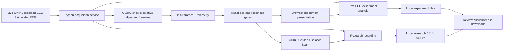

# Visual maps

[Open PDF atlas](visual-maps.pdf#page=2) | [Open in browser](visual-maps.html#diagram-1)
Maps of the implementation in this working tree, traced on November 11, 2026. Start with the system overview, then follow a topic below. Each map displays a rendered SVG preview and links to its editable source. Open the PDF atlas or the self-contained HTML viewer above to browse every diagram directly; neither needs Mermaid support or a network connection.

[Open full-size SVG](rendered/overview.svg)

Editable Mermaid source

There is also a score-only `synthetic` source: it bypasses raw EEG acquisition and baseline collection, so it can drive the games but cannot start an EEG experiment. No source is substituted automatically.

| Map | Questions it answers |
| --- | --- |
| [Runtime and ownership](system/runtime.md) | What runs in the browser and Python? Who owns acquisition, timing and files? |
| [Signal pipeline](data/signal-pipeline.md) | How does raw EEG become a score? Where do filtering, calibration and quality gates happen? |
| [Recording and review](data/recording-and-review.md) | What is saved, how are samples linked to game events, and how do review/export work? |
| [Frontend components and functions](code/frontend.md) | How do screens, game models, renderers and browser logging connect? |
| [Backend functions and APIs](code/backend.md) | Which functions run on startup, each acquisition tick and each API request? |
| [Player journey and game lifecycle](flows/player-journey.md) | How do connect, calibrate, choose, play, pause and reset fit together? |
| [Experiment journeys](flows/experiments.md) | How do Bilateral, SSVEP Cards and SSVEP Circle start, record, analyze and stop? |
| [Development, build and release](build/development-and-release.md) | What do npm scripts, version guards, CI and build metadata do? |
| [Assets and offline tools](build/tooling-and-assets.md) | How are photos, replay files, score traces and export checks produced? |

Solid arrows show data transfer, calls or a transition named on the arrow; dotted arrows show supporting configuration or metadata. Maps describe implemented paths, not proof of physical-headset performance or optical stimulus timing. Nominal rates describe scheduling targets, not guaranteed throughput.

When changing a boundary, update its map and source links. Keep detailed guides in the [dashboard docs](../dashboard/README.md), textual contracts in [architecture](../build/architecture.md), and dated test evidence in the [archive](../../archive/README.md).

Exports can be rebuilt with the [map export tools](../../../tools/docs/README.md). Keep the PDF, HTML and SVGs in sync when changing a diagram.
