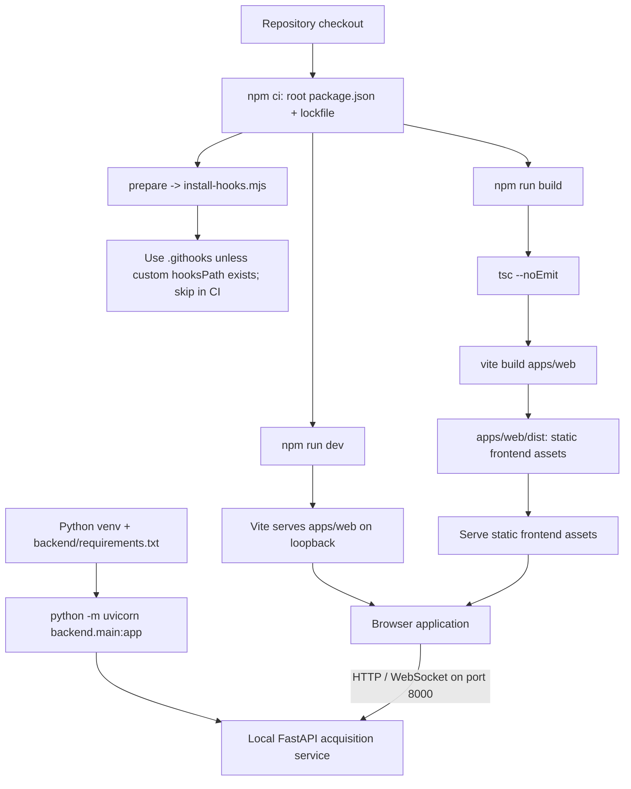
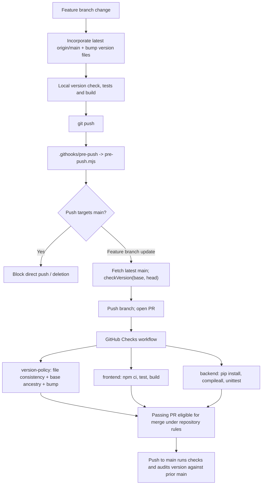
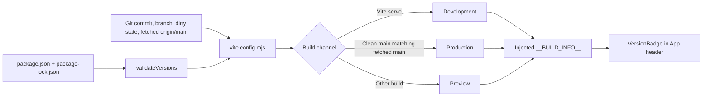

# Development, build and release

[Open PDF atlas](../visual-maps.pdf#page=22) | [Open in browser](../visual-maps.html#diagram-21)
[Map index](../README.md) · [Runtime](../system/runtime.md) · [Release rules](../../../archive/logs/releases.md)

## Install, run and build

[Open full-size SVG](build-visuals/development-and-release-install-run-and-build.svg)

Editable Mermaid source

There is one root npm package. The frontend's HTML/source live under `apps/web`; there is no separate frontend package install. The Python runtime and optional asset-generation tools have separate dependencies. Building the frontend does not launch Python or deploy the app.

| Command | Implementation / result |
| --- | --- |
| `npm run dev` | `vite apps/web --host 127.0.0.1`; loads [vite.config.mjs](../../../../apps/web/vite.config.mjs). |
| `npm run build` | Typecheck, then bundle frontend into `apps/web/dist`. |
| `npm test` | `node --import tsx --test tests/*.test.ts`; pure models, input/lifecycle, timing, research and version-policy checks. |
| `npm run version:check` | [check-version.mjs](../../../../tools/release/check-version.mjs): package/lockfile/current documentation consistency and archived overview validation. |
| `npm run version:check-main` | Same check with `--base origin/main`: ancestry, one permitted increment, an overview for the previous main version and retention of existing archives. It uses the fetched local ref; the pre-push hook fetches it again. |
| `npm run hooks:install` | [install-hooks.mjs](../../../../tools/release/install-hooks.mjs): configure the local push guard. |
| `python -m unittest discover -s backend -p 'test_*.py'` | Backend tests; CI also runs `python -m compileall backend`. |

## Version guard and CI paths

[Open full-size SVG](build-visuals/development-and-release-version-guard-and-ci-paths.svg)

Editable Mermaid source

The hook runs only when installed and is local. The repository includes a [GitHub branch-protection configuration](../../../../.github/main-protection.json) for the three checks; the presence of that file does not establish that it has been applied on GitHub. This map describes code/configuration, not a verified remote setting. The workflow contains checks, not a deployment job.

## Build information shown in the header

[Open full-size SVG](build-visuals/development-and-release-build-information-shown-in-the-header.svg)

Editable Mermaid source

Metadata is captured when Vite starts/builds. Restart the dev server after changing branch or version. The Production label identifies a source state; it does not publish a build.

Source: [package.json](../../../../package.json), [version-policy.mjs](../../../../tools/release/version-policy.mjs), [push hook](../../../../.githooks/pre-push), [checks.yml](../../../../.github/workflows/checks.yml), [VersionBadge.tsx](../../../../apps/web/src/VersionBadge.tsx). Startup commands are in the [repository README](../../../../README.md).
