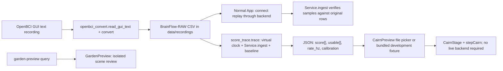
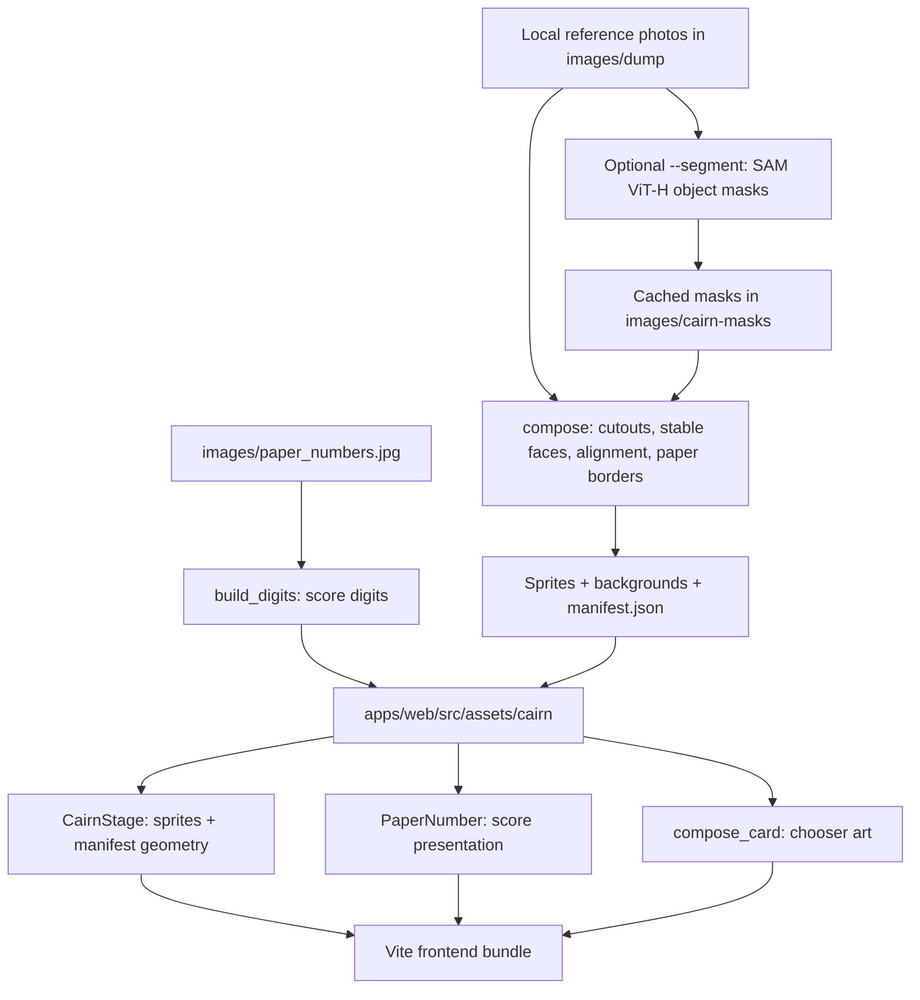
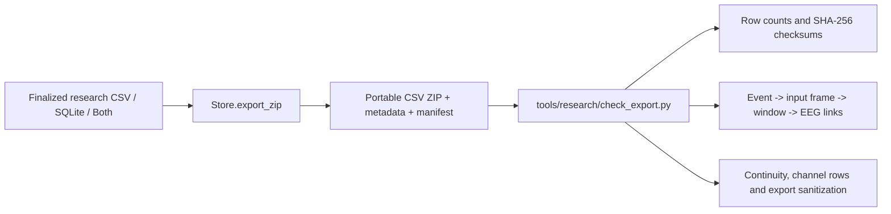

# Offline tooling and asset pipelines

[Open PDF atlas](../visual-maps.pdf#page=25) | [Open in browser](../visual-maps.html#diagram-24)
[Map index](../README.md) · [Build map](development-and-release.md) · [Recording joins](../data/recording-and-review.md)

## Recording conversion and no-headset game testing

[Open full-size SVG](build-visuals/tooling-and-assets-recording-conversion-and-no-headset-game-testing.svg)

Editable Mermaid source

The converter maps supported GUI text rows to BrainFlow's 24-row Cyton format. `score_trace` reuses the backend's feature/calibration pipeline with a deterministic virtual clock; it is not a substitute for testing the real board or fresh stimulus responses. Preview routes are enabled only in development.

| Tool | Input -> output / entry point |
| --- | --- |
| [backend/openbci_convert.py](../../../../backend/openbci_convert.py) | GUI text -> BrainFlow CSV; `python -m backend.openbci_convert <source.txt> --out data/recordings`. |
| [backend/score_trace.py](../../../../backend/score_trace.py) | BrainFlow CSV -> score trace JSON; `python -m backend.score_trace <recording.csv> --out <trace.json>`. Optional `--calibrate-at` and `--gate` control the trace. |
| [CairnPreview.tsx](../../../../apps/web/src/CairnPreview.tsx) | `/?cairn-preview`: load a trace, choose mode/speed, or use explicit slider/sine test inputs. Development fixture JSONs are discovered through `import.meta.glob`. |
| [GardenPreview.tsx](../../../../apps/web/src/GardenPreview.tsx) | `/?garden-preview`: review the garden presentation without an EEG acquisition session. |

Keep participant recordings and private-derived traces local. A fixture's presence in a development path does not make its data suitable for committing.

## Cairn photo assets

[Open full-size SVG](build-visuals/tooling-and-assets-cairn-photo-assets.svg)

Editable Mermaid source

The asset script is an on-demand authoring tool, not part of `npm run build`. Segmentation uses optional heavyweight model tooling; recomposition uses cached masks and image-processing libraries. Its defaults keep original photos under ignored `images/dump` and write reusable generated assets to the frontend asset directory.

| Mode | What it runs |
| --- | --- |
| `python tools/cairn_assets/build_cairn_assets.py --segment` | Run segmentation, then compose sprites/digits/card. |
| `python tools/cairn_assets/build_cairn_assets.py` | Recompose from existing photos/masks, then build digits/card. |
| `python tools/cairn_assets/build_cairn_assets.py --digits` | Rebuild score digits only. |

Source: [build_cairn_assets.py](../../../../tools/cairn_assets/build_cairn_assets.py), [manifest.json](../../../../apps/web/src/assets/cairn/manifest.json), [cairnGeometry.ts](../../../../apps/web/src/cairnGeometry.ts), [CairnStage.tsx](../../../../apps/web/src/CairnStage.tsx), [PaperNumber.tsx](../../../../apps/web/src/PaperNumber.tsx).

## Research export inspection

[Open full-size SVG](build-visuals/tooling-and-assets-research-export-inspection.svg)

Editable Mermaid source

Run `python tools/research/check_export.py <research-export.zip>` against an actual exported recording. The [checker](../../../../tools/research/check_export.py) inspects recorded structure and consistency; the result does not establish physiological validity or physical stimulus timing.
