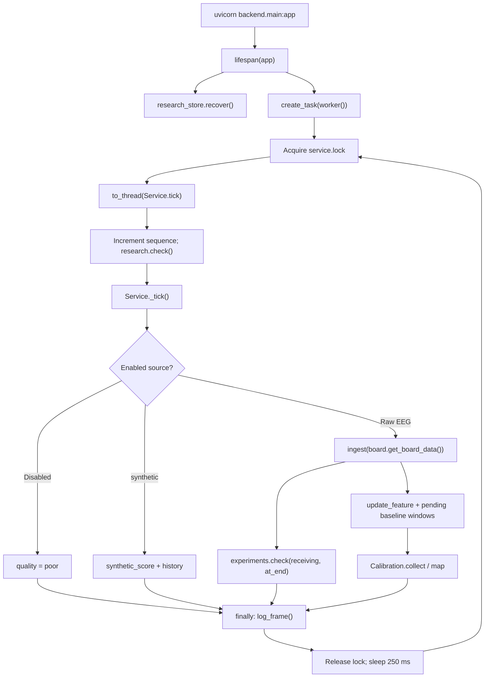
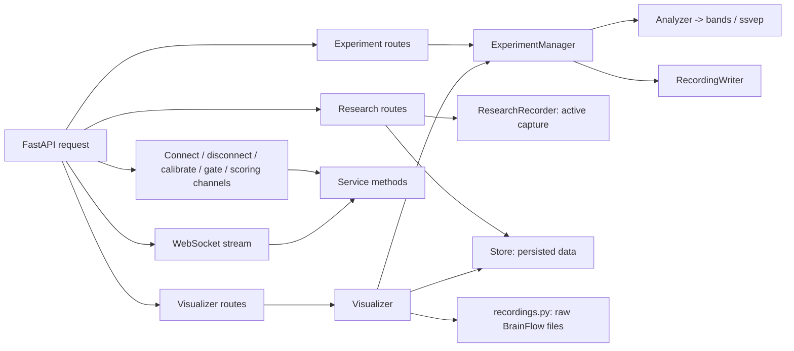

# Backend functions and API boundaries

[Open PDF atlas](../visual-maps.pdf#page=14) | [Open in browser](../visual-maps.html#diagram-13)
[Map index](../README.md) · [Runtime](../system/runtime.md) · [Signal details](../data/signal-pipeline.md)

## Startup and acquisition tick

[Open full-size SVG](code-visuals/backend-startup-and-acquisition-tick.svg)

Editable Mermaid source

The worker catches acquisition exceptions, records the error and calls `Service.stop()`. Tick logging is in a `finally` block so unusable frames remain visible in research capture. The HTTP control routes also use the service lock when changing acquisition or baseline settings. `stream()` sends snapshots independently of the worker, as shown in the [runtime map](../system/runtime.md).

Shutdown cancels the worker, stops the acquisition/active experiment and, if a research recording is active, requests its stop and waits for finalization for up to ten seconds.

## Request dispatch

[Open full-size SVG](code-visuals/backend-request-dispatch.svg)

Editable Mermaid source

| Route family | Handler path and responsibilities |
| --- | --- |
| `GET /health`, `/api/status`, `/api/options`, `/api/recording` | Health, `Service.status()`, local input discovery and `inspect_recording()`. Preview metadata does not feed the acquisition buffer. |
| `POST /api/connect`, `/api/disconnect` | `Service.connect()` / `stop()`: release previous board, create a new session on connect, reset baseline and notify recorders. |
| `POST /api/calibrate` | `begin_calibration()`: start a fresh baseline on the existing stream position. |
| `POST /api/gate`, `/api/scoring-channels` | `set_gate()` / `set_scoring_channels()`: validate settings, invalidate the baseline, update diagnostics. |
| `WS /ws/input` | `stream()`: `frame()` plus `status()` telemetry to each viewer. |
| `/api/experiments/...` | Start validation, clock, owner heartbeat, ordered events, frame batches, thresholds, stop, history and ZIP export. |
| `POST /api/simulation` | Set simulated gaze on `SimulatedBoard`; cannot set a live participant's EEG response. |
| `/api/research/destinations/...` | `Destinations`: list/add/probe local capture destinations. |
| `/api/research/recordings/...` | `ResearchRecorder`: start/items/heartbeat/stop; `Store`: history/detail/window/CSV/ZIP/database. |
| `GET /api/research/clock` | Clock exchange for research event alignment. |
| `GET /api/visualizer/runs`, `/analysis`, `/table` | `visualizer_router()` -> `Visualizer.runs()` / `analysis()` / `table()`. |

## Numerical and storage modules

| Source | Functions/classes to follow |
| --- | --- |
| [main.py](../../../../backend/main.py) | `Service`, `worker`, `lifespan`, all top-level HTTP/WebSocket handlers. |
| [signal.py](../../../../backend/signal.py) | `analyze`, `filtered_window`, `Calibration`: game feature, quality and score mapping. |
| [continuity.py](../../../../backend/continuity.py) | `CounterTracker`, `timestamp_problem`: sample continuity. |
| [recordings.py](../../../../backend/recordings.py) | `resolve_recording`, `inspect_recording`: constrained paths and raw-file metadata. |
| [experiments.py](../../../../backend/experiments.py) | `ExperimentManager.start`, `on_samples`, `_end`; `Analyzer._samples`, `_event`, `_advance_trial`, `_metrics`. |
| [ssvep.py](../../../../backend/ssvep.py) | `decode_window`, `cca_scores`, `TrialTracker`, `accept`, `select_thresholds`, `summarize`. |
| [bands.py](../../../../backend/bands.py) | `window_metrics`: descriptive experiment band metrics. |
| [research/recorder.py](../../../../backend/research/recorder.py) | `ResearchRecorder`, `Writer`: producer hooks, ownership and finalization. |
| [research/store.py](../../../../backend/research/store.py) | `Store`, `Reader`: recovery, window reads and exports. |
| [visualizer.py](../../../../backend/visualizer.py) | Raw/research/experiment analysis adapters and `spectrum`. |

See [recording and review](../data/recording-and-review.md) for storage threads and join keys, and [experiment journeys](../flows/experiments.md) for decoding versus display timing.
