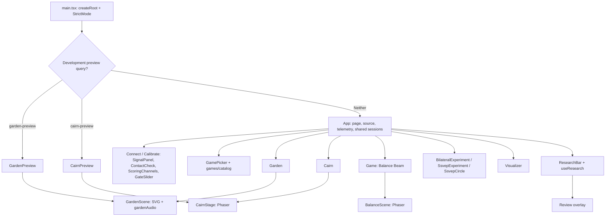
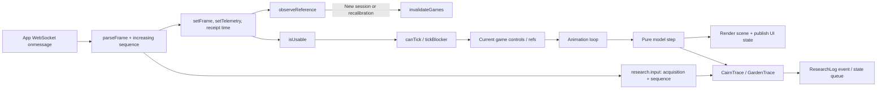
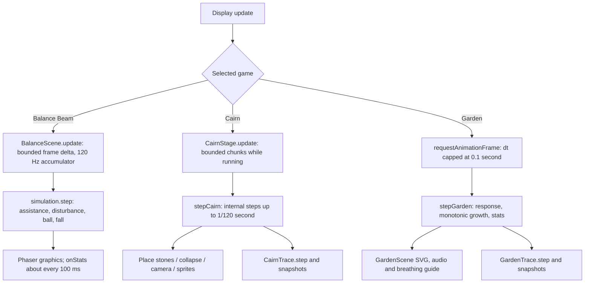

# Frontend components and function paths

[Open PDF atlas](../visual-maps.pdf#page=11) | [Open in browser](../visual-maps.html#diagram-10)
[Map index](../README.md) · [Player journey](../flows/player-journey.md) · [Recording](../data/recording-and-review.md)

## Entry points and component ownership

[Open full-size SVG](code-visuals/frontend-entry-points-and-component-ownership.svg)

Editable Mermaid source

The normal page state is `setup`, `calibrate`, `choose`, `play` or `visualizer`. The initial `#visualizer` hash opens Visualizer directly. Research controls and Review are overlays around this flow, rather than separate acquisition sessions. Dev preview queries are enabled only when `import.meta.env.DEV` is true.

## From a network frame to a rendered game

[Open full-size SVG](code-visuals/frontend-from-a-network-frame-to-a-rendered-game.svg)

Editable Mermaid source

React owns navigation and controls. Mutable refs hold the latest controls/model for animation callbacks. A missing telemetry update is treated as an outage; an observed new session or transition into calibration invalidates rounds tied to the old comparison reference.

## Game update loops

[Open full-size SVG](code-visuals/frontend-game-update-loops.svg)

Editable Mermaid source

Paused game progress does not catch up after a background-tab delay. Presentation can still finish a fall animation or settle an ambient visual; those animations do not imply gameplay time is advancing. Research state snapshots for Cairn/Garden target 20 Hz rather than copying every display frame. Balance Beam consumes the shared score but has no equivalent dedicated game-state trace class in this implementation.

| Source | Functions or behavior to follow |
| --- | --- |
| [main.tsx](../../../../apps/web/src/main.tsx) | `createRoot`; choose App or a dev preview. |
| [App.tsx](../../../../apps/web/src/App.tsx) | `refresh`, `command`, `setGate`, `invalidateGames`, `start`, `startGarden`, `requestGarden`, `startCairn`, `openGame`, `navigate`. |
| [input.ts](../../../../apps/web/src/input.ts), [lifecycle.ts](../../../../apps/web/src/games/lifecycle.ts) | `parseFrame`, `isUsable`, `observeReference`, `canTick`, `tickBlocker`. |
| [Game.tsx](../../../../apps/web/src/Game.tsx), [simulation.ts](../../../../apps/web/src/simulation.ts) | `BalanceScene.update`, `initialState`, `step`. |
| [Cairn.tsx](../../../../apps/web/src/Cairn.tsx), [CairnStage.tsx](../../../../apps/web/src/CairnStage.tsx), [cairnSimulation.ts](../../../../apps/web/src/cairnSimulation.ts) | Round UI/history, Phaser renderer, `initialCairn`, `stepCairn`, events and fall thresholds. |
| [Garden.tsx](../../../../apps/web/src/Garden.tsx), [gardenSimulation.ts](../../../../apps/web/src/gardenSimulation.ts), [GardenScene.tsx](../../../../apps/web/src/GardenScene.tsx) | Settle-in/plant lifecycle, `stepGarden`, `drive`, `stageOf`, `visuals`, SVG presentation. |
| [cairnTrace.ts](../../../../apps/web/src/research/cairnTrace.ts), [gardenTrace.ts](../../../../apps/web/src/research/gardenTrace.ts) | Model transitions, pause/resume, settings, state snapshots and partial recording starts. |
| [cairnScores.ts](../../../../apps/web/src/cairnScores.ts), [gardenPrefs.ts](../../../../apps/web/src/gardenPrefs.ts) | Browser-local records/preferences; separate from backend research files. |
| [visualizer/model.ts](../../../../apps/web/src/visualizer/model.ts), [Visualizer.tsx](../../../../apps/web/src/visualizer/Visualizer.tsx) | `useLiveData`, live/recorded/compare/table views. |

Experiment presentation and its owner-side session hook have a separate [experiment map](../flows/experiments.md).
