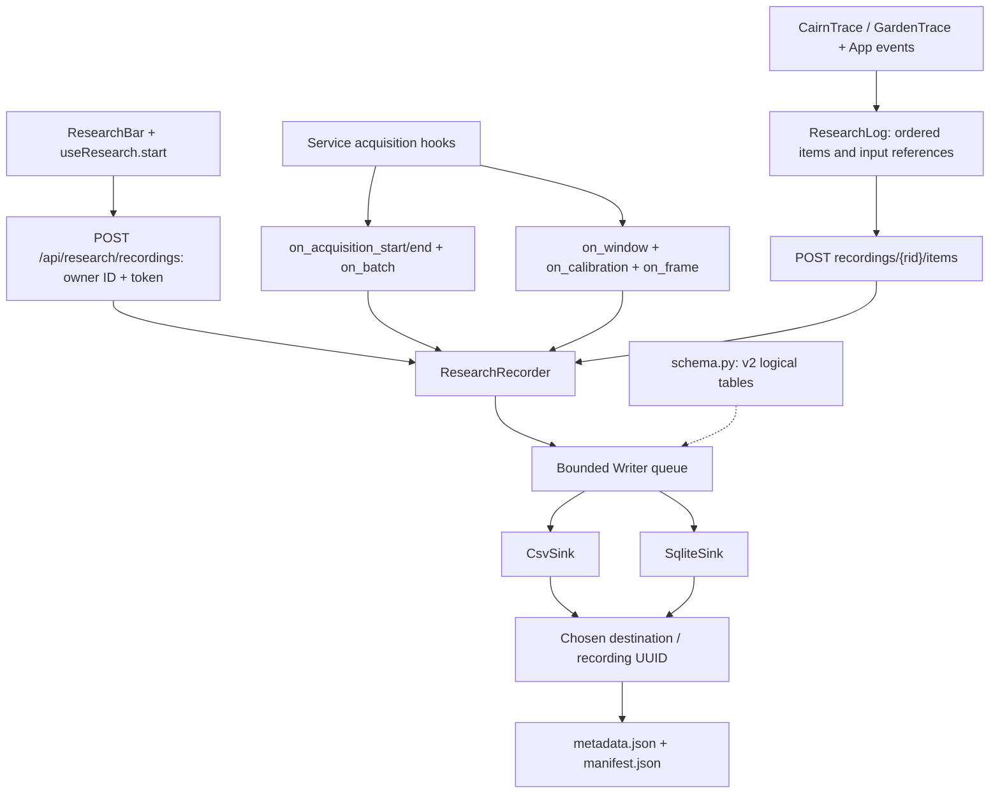
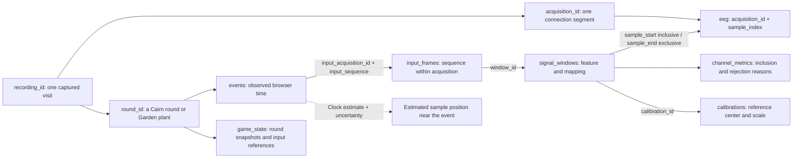
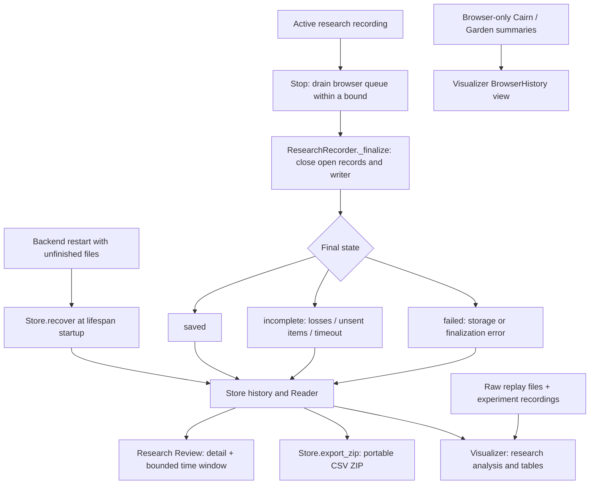

# Recording, joins and review

[Open PDF atlas](../visual-maps.pdf#page=8) | [Open in browser](../visual-maps.html#diagram-7)
[Map index](../README.md) · [Signal pipeline](signal-pipeline.md) · [Experiment flow](../flows/experiments.md)

## Research / Dev Mode capture

[Open full-size SVG](data-visuals/recording-and-review-research-dev-mode-capture.svg)

Editable Mermaid source

The selected format creates CSV, SQLite, or both. The default destination is `data/research/`; `BCI_RESEARCH_DIR` and configured destinations can change it. Recording may begin before connection or partway through a session and can span reconnects, recalibration and game switches. Beginning mid-session is marked as partial rather than inventing earlier data.

Game snapshots target about 20 Hz; transitions and events carry their own times. The browser retains research items until acknowledged and the backend deduplicates their sequences. A worker-backed timer drives flushing and heartbeats, with a normal timer fallback. This does not guarantee delivery if the browser or computer terminates.

## Trace one event back to EEG

[Open full-size SVG](data-visuals/recording-and-review-trace-one-event-back-to-eeg.svg)

Editable Mermaid source

These are logical joins in the recorded schema, not a claim that every storage format enforces foreign keys. The input-frame reference identifies the score the game consumed. Clock-aligned sample estimates identify nearby raw data with uncertainty; browser event times are not exact hardware sample triggers. Score-only synthetic frames have no raw EEG window.

## Save, recover and inspect

[Open full-size SVG](data-visuals/recording-and-review-save-recover-and-inspect.svg)

Editable Mermaid source

Stop does not stop acquisition or automatically end ordinary gameplay. A recording finalizes asynchronously; file completion and losses determine its final state. Owner loss after five seconds or a full storage queue ends capture with an explicit incomplete/failed outcome. Export reads persisted files; SQLite-only research recordings can still export CSV ZIPs. Inspect active capture in Live rather than treating it as a finalized recording.

Experiment recording uses a separate `RecordingWriter` and schema: `eeg.csv`, event/frame/prediction/metric JSONL files, metadata and a summary under `data/experiments/` by default (`BCI_EXPERIMENTS_DIR` overrides it). Experiments and research capture share the acquisition producer but cannot record concurrently.

| Implementation | Role |
| --- | --- |
| [logger.ts](../../../../apps/web/src/research/logger.ts), [useResearch.ts](../../../../apps/web/src/research/useResearch.ts) | Browser queue, ownership, clock sync, heartbeat, start and stop. |
| [recorder.py](../../../../backend/research/recorder.py), [schema.py](../../../../backend/research/schema.py), [sinks.py](../../../../backend/research/sinks.py) | Sample/feature/frame capture, tables and durable writes. |
| [store.py](../../../../backend/research/store.py), [destinations.py](../../../../backend/research/destinations.py) | Recovery, recorded data access, exports and locations. |
| [Review.tsx](../../../../apps/web/src/research/Review.tsx) | Research recording detail and Cairn/Garden inspectors. |
| [visualizer.py](../../../../backend/visualizer.py), [Visualizer.tsx](../../../../apps/web/src/visualizer/Visualizer.tsx) | Unified raw/research/experiment analysis, tables and comparisons. |
| [experiments.py](../../../../backend/experiments.py), [experiment_recording.py](../../../../backend/experiment_recording.py) | Experiment ownership, analysis and recording files. |

Operator details: [Research / Dev Mode](../../dashboard/devtools/operating.md) and [Visualizer](../../dashboard/visualizer.md).
