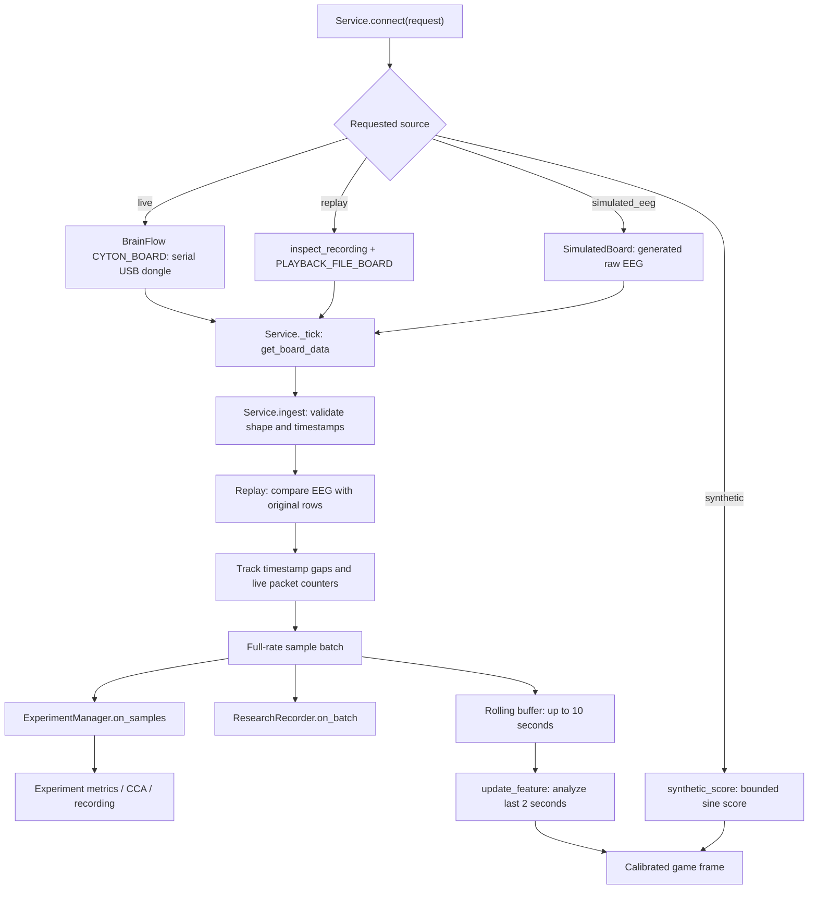
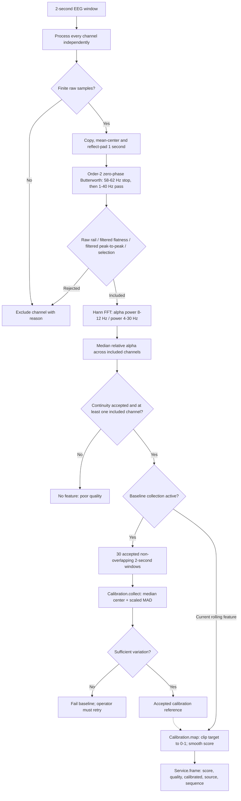
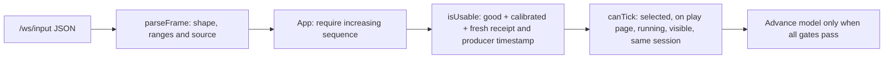

# EEG to game input

[Open PDF atlas](../visual-maps.pdf#page=5) | [Open in browser](../visual-maps.html#diagram-4)
[Map index](../README.md) · [Recording joins](recording-and-review.md) · [Game lifecycle](../flows/player-journey.md)

## Acquisition and fan-out

[Open full-size SVG](data-visuals/signal-pipeline-acquisition-and-fan-out.svg)

Editable Mermaid source

Cyton's configured layout is eight EEG channels at 250 Hz. SDK reads arrive in batches; their sizes are not assumed to equal a feature window. Full-rate recording and experiment analysis branch before the game amplitude gate. Chart telemetry is a reduced view of the rolling buffer, not the samples used for decoding or recording.

Replay uses the file's original timestamps for continuity and position. A mismatched EEG row stops acquisition. A receipt outage over two seconds clears rolling and pending baseline buffers so opposite sides of a gap are not joined into a window.

## Per-window processing and calibration

[Open full-size SVG](data-visuals/signal-pipeline-per-window-processing-and-calibration.svg)

Editable Mermaid source

Baseline collection and the rolling play feature share `analyze()`; the diagram separates their consumers. Baseline time means **accepted data**: rejected windows do not advance the 60-second target. Live EEG requires an explicit scoring-channel selection before calibration. Raw mains-hum RMS is measured separately for diagnostics; the notch filter does not establish electrode contact.

Game continuity checks tolerate limited packet-counter noise: `CounterTracker` distinguishes confirmed loss from isolated corrupt counters, with per-window loss/corruption limits. Timestamp checks reject backward time or an excessive total window span rather than every bursty USB arrival. Experiments also receive stricter raw-counter break positions. See `continuity.py` and `Service.ingest()` for those separate policies.

The mapped target is `clip(0.5 + (value - center) / (6 * scale), 0, 1)` and smoothing is `0.8 * prior + 0.2 * target` per map call. Gate or scoring-channel changes invalidate the old baseline. These are experimental relative-alpha values, not validated attention or stress measurements.

## Browser acceptance

[Open full-size SVG](data-visuals/signal-pipeline-browser-acceptance.svg)

Editable Mermaid source

`isUsable()` checks both the monotonic receipt age and the producer's wall-clock timestamp against a two-second limit; it also rejects a producer timestamp over two seconds in the future. Acquisition freshness is checked separately by the backend. Recovery of usable input does not press Resume for the player.

| Code | Main functions |
| --- | --- |
| [main.py](../../../../backend/main.py) | `Service.connect`, `ingest`, `update_feature`, `begin_calibration`, `frame`, `receiving`. |
| [signal.py](../../../../backend/signal.py) | `filtered_window`, `hum_rms`, `analyze`, `Calibration.collect`, `Calibration.map`. |
| [continuity.py](../../../../backend/continuity.py) | `CounterTracker.feed`, `problem`, `timestamp_problem`. |
| [input.ts](../../../../apps/web/src/input.ts) and [lifecycle.ts](../../../../apps/web/src/games/lifecycle.ts) | Packet parsing, freshness and tick gates. |
