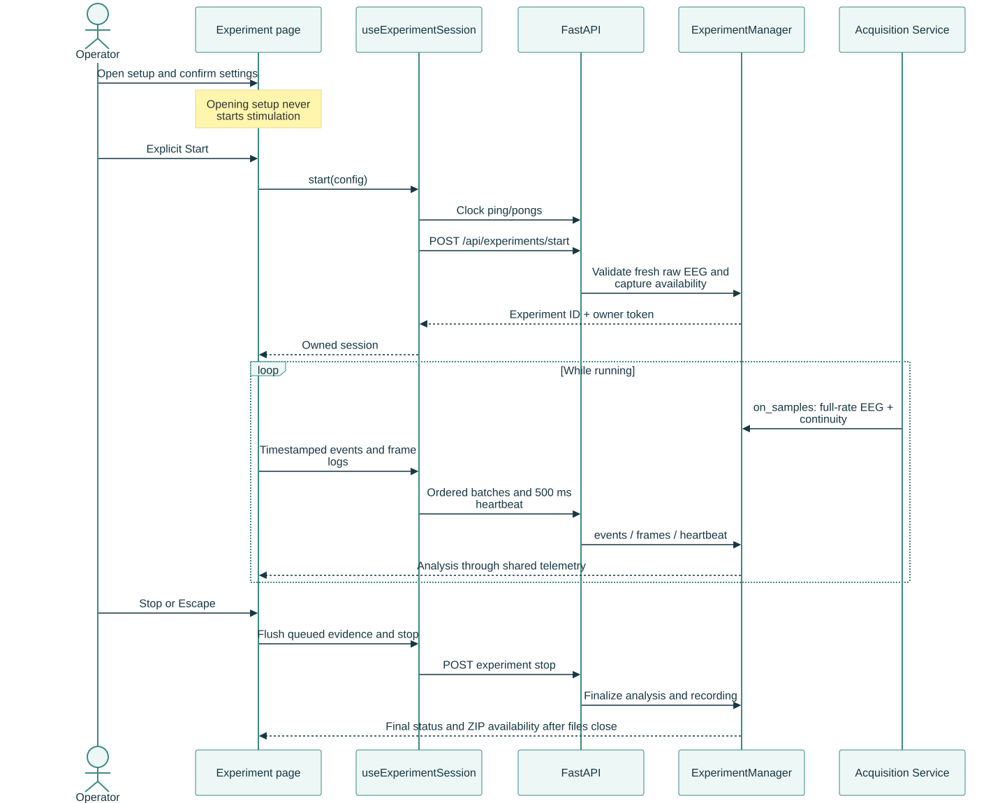
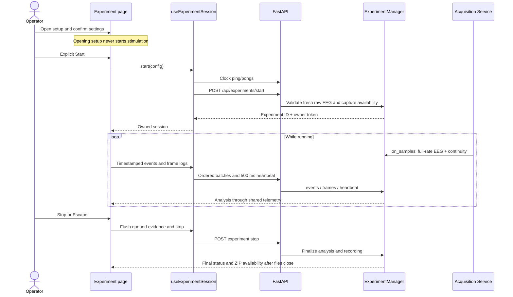
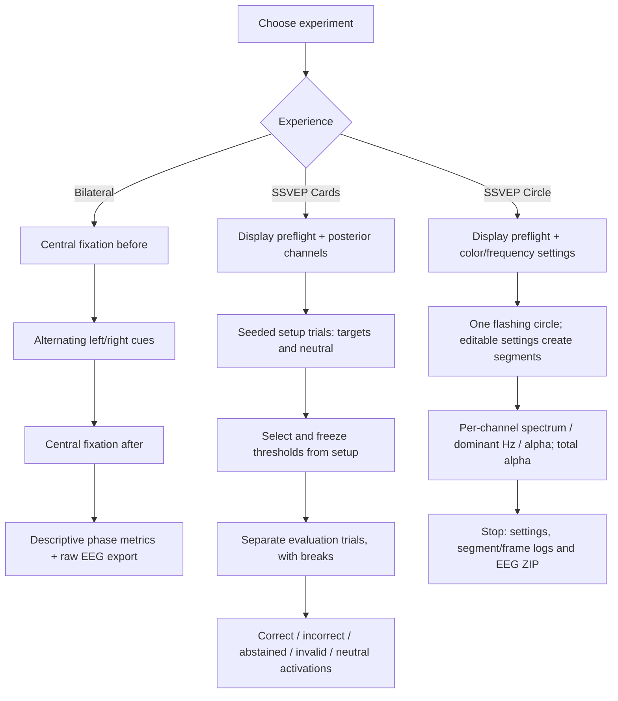
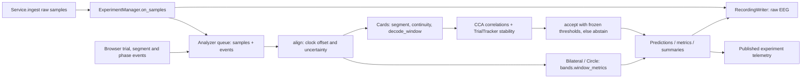

# Experiment presentation and analysis

[Open PDF atlas](../visual-maps.pdf#page=19) | [Open in browser](../visual-maps.html#diagram-18)
[Map index](../README.md) · [Acquisition](../data/signal-pipeline.md) · [Recording](../data/recording-and-review.md)

## Shared start and ownership

[Open full-size SVG](../rendered/flows/experiments-shared-start-and-ownership.svg)

Editable Mermaid source

Start requires raw input from `live`, `replay` or `simulated_eeg`, not score-only `synthetic`. Alpha calibration is not required. The UI and backend reject overlap with an active research recording or another experiment. SSVEP pages additionally require a passing display check and acknowledgement; Cards also validates its posterior-channel configuration.

The session hook resynchronizes clocks and serializes event/frame delivery. Failed delivery interrupts the run rather than declaring a complete trial. Leaving/unmounting the page, hidden tabs, input/source problems and owner loss stop or interrupt presentation/capture; a server heartbeat timeout is two seconds. Partial recordings remain available. Browser callback logs describe software scheduling, not measured emitted light.

## Three different protocols

[Open full-size SVG](../rendered/flows/experiments-three-different-protocols.svg)

Editable Mermaid source

Cards supports diagnostic evaluation that abstains when usable thresholds are unavailable; freezing does not guarantee acceptance. Circle is an observation/recording experiment, not a gaze classifier. Bilateral records the chosen follow/fixate instruction condition and descriptive metrics; it is not a P300 classifier or therapeutic assessment.

## Where decoding happens

[Open full-size SVG](../rendered/flows/experiments-where-decoding-happens.svg)

Editable Mermaid source

In Cards, the instructed target is used for setup/evaluation labels. The decoder computes correlations from raw EEG and frequency references; it does not read the cue as its answer. Replayed resting EEG and generated signals can exercise this software path without validating a new participant response.

| Source | Follow these paths |
| --- | --- |
| [session.ts](../../../../apps/web/src/experiments/session.ts) | `syncClock`, `useExperimentSession`, `start`, `log`, `sendFrames`, `freezeThresholds`, `stop`. |
| [protocol.ts](../../../../apps/web/src/experiments/protocol.ts), [timing.ts](../../../../apps/web/src/experiments/timing.ts), [circle.ts](../../../../apps/web/src/experiments/circle.ts) | Seeded blocks, bilateral phases, frame timing and circle scheduling. |
| [BilateralExperiment.tsx](../../../../apps/web/src/experiments/BilateralExperiment.tsx), [SsvepExperiment.tsx](../../../../apps/web/src/experiments/SsvepExperiment.tsx), [SsvepCircle.tsx](../../../../apps/web/src/experiments/SsvepCircle.tsx) | Page-specific setup, animation loops and interruption handlers. |
| [main.py](../../../../backend/main.py), [experiments.py](../../../../backend/experiments.py) | `validate_start`, start endpoint, manager ownership, analyzer and watchdog. |
| [ssvep.py](../../../../backend/ssvep.py), [bands.py](../../../../backend/bands.py) | `decode_window`, `TrialTracker`, `accept`, `select_thresholds`, `window_metrics`. |

More operator detail: [experiment guides](../../dashboard/experiments/README.md).
