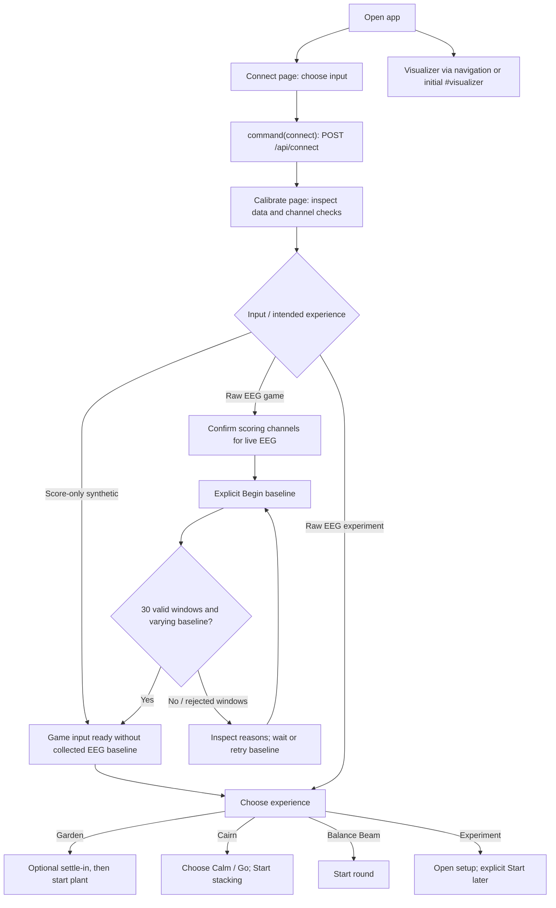
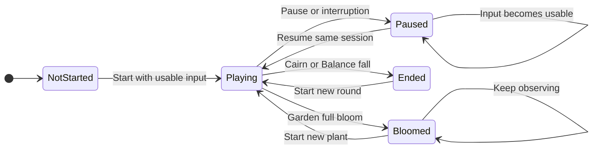
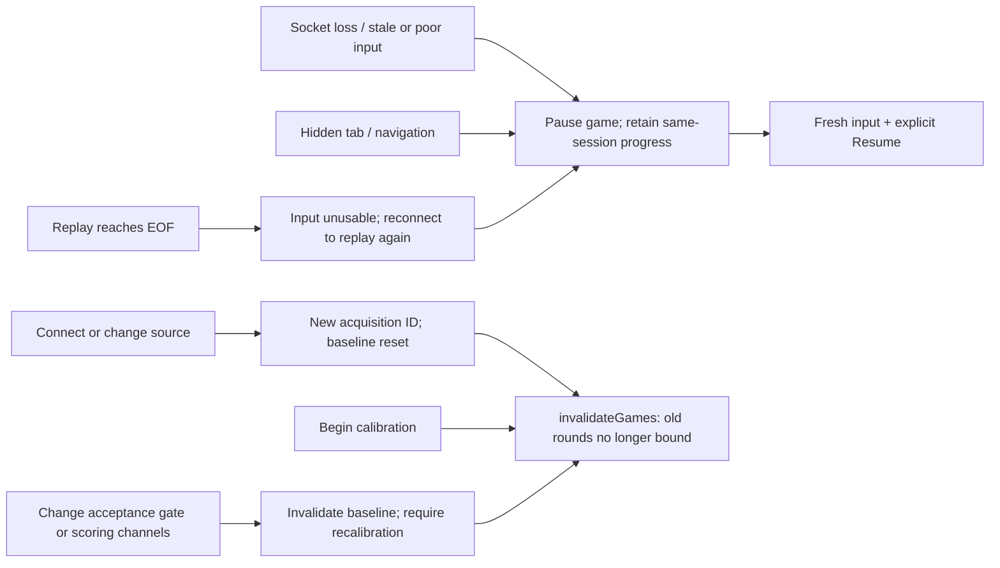

# Player journey and game lifecycle

[Open PDF atlas](../visual-maps.pdf#page=16) | [Open in browser](../visual-maps.html#diagram-15)
[Map index](../README.md) · [Signal pipeline](../data/signal-pipeline.md) · [Experiment journeys](experiments.md)

## Connect to an experience

[Open full-size SVG](flows-visuals/player-journey-connect-to-an-experience.svg)

Editable Mermaid source

The map shows a common journey, not a forced page wizard: navigation can open Choose or Visualizer independently. Experiment setup can open without ready input; its Start button has separate raw-EEG requirements. Calibrate is unnecessary for experiments. Opening a game never reconnects or rewinds acquisition.

## Per-game lifecycle

[Open full-size SVG](flows-visuals/player-journey-per-game-lifecycle.svg)

Editable Mermaid source

This is a conceptual lifecycle across the games, not a single enum in the code. A new acquisition or recalibration resets every state to NotStarted; that shared reset path is shown in the interruption map below. Full bloom is a Garden milestone rather than a fall/loss; growth caps at one. A new Garden plant may include the optional settle-in. Cairn and Balance rounds end on falls; a new round resets game state while retaining a valid current session baseline.

`canTick()` requires the selected game, play page, explicit running state, visible tab, usable frame and matching bound acquisition session. When a previously started game is reopened from Choose, `openGame()` preserves its same-session state and returns it paused. A fresh Cairn opens its start prompt; a fresh Garden enters its start/settle-in flow.

## What interrupts what

[Open full-size SVG](flows-visuals/player-journey-what-interrupts-what.svg)

Editable Mermaid source

Research capture can remain active across these game and acquisition transitions. Experiments are more restrictive: source changes, recalibration, leaving the page and other interruption conditions terminate the trial and retain its partial files. See [recording](../data/recording-and-review.md) and [experiment flows](experiments.md).

Source: [App.tsx](../../../../apps/web/src/App.tsx), [games/catalog.ts](../../../../apps/web/src/games/catalog.ts), [games/lifecycle.ts](../../../../apps/web/src/games/lifecycle.ts), [input.ts](../../../../apps/web/src/input.ts), [Service](../../../../backend/main.py).
