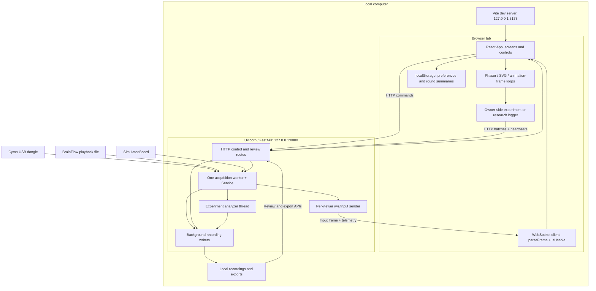
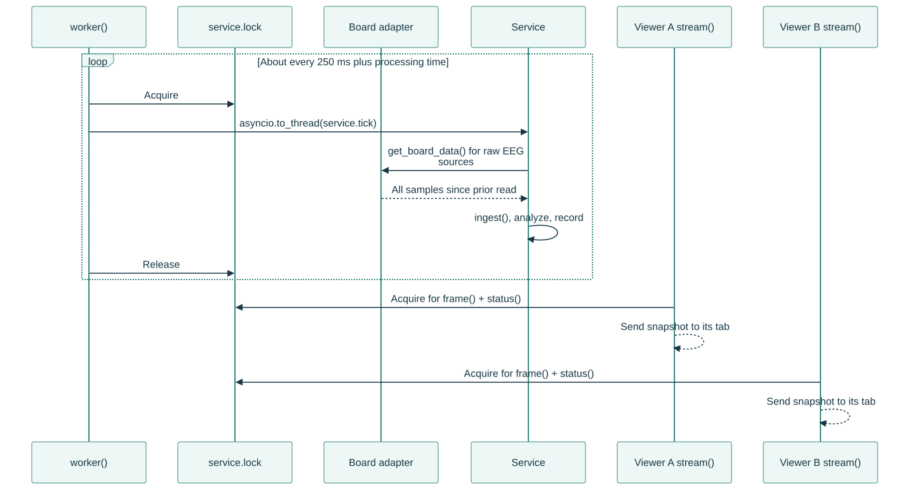
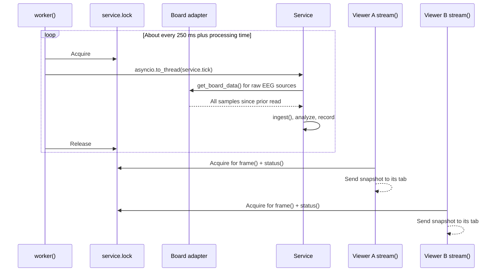

# Runtime and ownership

[Open PDF atlas](../visual-maps.pdf#page=3) | [Open in browser](../visual-maps.html#diagram-2)
[Map index](../README.md) · [Backend call paths](../code/backend.md) · [Frontend call paths](../code/frontend.md)

## Processes and connections

[Open full-size SVG](system-visuals/runtime-processes-and-connections.svg)

Editable Mermaid source

Vite serves the frontend in development. The frontend build produces static assets; Python remains a separately started backend. Browser requests name port 8000 directly; this app does not use a Vite API proxy.

## One producer, multiple viewers

[Open full-size SVG](system-visuals/runtime-one-producer-multiple-viewers.svg)

Editable Mermaid source

Each viewer polls snapshots at its own nominal 4 Hz cadence. A viewer never reads the board. Sequence numbers belong to the producer; the browser ignores repeated or out-of-order frames. An open WebSocket does not mean the headset is connected or the input is usable.

| Responsibility | Owner and implementation |
| --- | --- |
| Acquisition, baseline and shared settings | `Service`, `worker()`, `stream()` in [backend/main.py](../../../../backend/main.py). |
| Raw EEG simulation | [SimulatedBoard](../../../../backend/simulated.py); distinct from score-only synthetic input. |
| Experiment analysis and ownership | `ExperimentManager`, `Analyzer` in [experiments.py](../../../../backend/experiments.py). |
| Durable recording writes | [experiment writer](../../../../backend/experiment_recording.py) and [research writer](../../../../backend/research/recorder.py). |
| Navigation, round/session binding | [App.tsx](../../../../apps/web/src/App.tsx), [lifecycle.ts](../../../../apps/web/src/games/lifecycle.ts). |
| Game physics and stimulus display | Browser models and render loops; see [frontend map](../code/frontend.md). |

Only one experiment or one research recording may be active at a time; the start endpoints reject attempts to overlap the two. Ordinary viewers can observe telemetry, but recording mutations require the owning tab's token. Changing acquisition affects every viewer sharing this backend.
